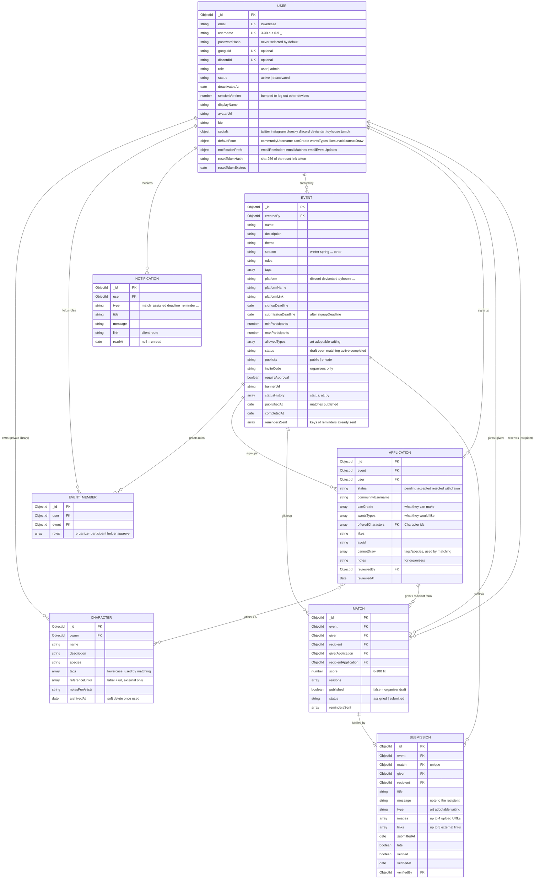

# Database

MongoDB through Mongoose (`server/models/`). Eight collections. Every document has `_id`, `createdAt` and `updatedAt`.
Relationships are ObjectId references; nothing relies on joins at the database level except the event listing,
which counts accepted applications with a `$lookup`.

## Collections

| Collection | Model | What it holds | Indexes |
| --- | --- | --- | --- |
| `users` | `User` | Accounts, profile, sign-up form defaults, email preferences | `email` unique, `username` unique, `googleId` unique, `discordId` unique |
| `eventmembers` | `EventMember` | One row per (user, event) with that person's roles in the event | `(user, event)` unique, `(event, roles)` |
| `notifications` | `Notification` | In-app notifications (emails are sent alongside, not stored) | `(user, createdAt desc)`, `(user, readAt)` |
| `characters` | `Character` | Each person's private character library | `owner`, `(owner, archivedAt, updatedAt desc)` |
| `events` | `Event` | Exchanges and their lifecycle | `status`, `inviteCode`, `(publicity, status, signupDeadline)` |
| `applications` | `Application` | Sign-up forms, one per person per event | `(event, user)` unique, `(event, status)`, `offeredCharacters` |
| `matches` | `Match` | Who makes a gift for whom; drafts until published | `(event, giver)` unique, `(event, recipient)` |
| `submissions` | `Submission` | The finished gift for one match | `match` unique, `event` |
| `auditlogs` | `AuditLog` | Every site admin action (bans, role changes, deleting or moderating events) with the reason | `createdAt desc`, `(targetType, targetId, createdAt desc)` |
| `jobruns` | `JobRun` | When each background job last ran (`_id: 'reminders'`), so serverless instances share one schedule | `_id` |
| `uploads.files`, `uploads.chunks` | GridFS | Uploaded images and demo artwork when the database is a shared one (Atlas); served at `/api/files/<id>.<ext>` | GridFS defaults |

## How the pieces fit

- **Roles are per event.** Organisers and participants are `EventMember` rows, not fields on `User` or `Event`.
  Creating an event grants `organizer`; an accepted application grants `participant`; a user can hold both.
  `User.role` is only for site admins.
- **Characters are reused.** Applications point at characters in the owner's library. A character that any application
  references can't be deleted, only archived (`archivedAt`), so past events keep their references.
- **One loop per event.** Each accepted participant is a `giver` exactly once and a `recipient` exactly once in the
  published matches of an event. `giverApplication` / `recipientApplication` keep the forms the match was made from.
- **Secrecy is enforced in the API, not the schema.** A recipient's match row names their giver, so routes never return
  it to them before the event is `completed`; applications are only returned to their owner and the organisers.
- **Uploads are stored as URLs.** `bannerUrl`, `avatarUrl` and `Submission.images` hold URLs from
  `services/storage.js`: `/api/files/<id>.<ext>` for GridFS (the default with a connection string, so Vercel can
  serve them), an Azure Blob Storage URL, or `/uploads/...` for files in `server/uploads/` with the local database.
- **Deactivation** sets `User.status`; after 30 days the reminder job anonymises the account in place so references from
  events, matches and submissions stay valid.
